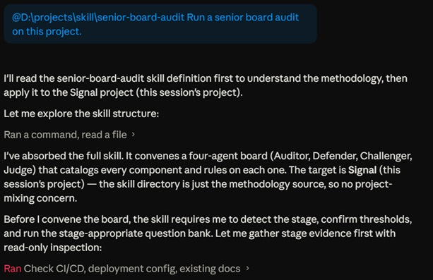
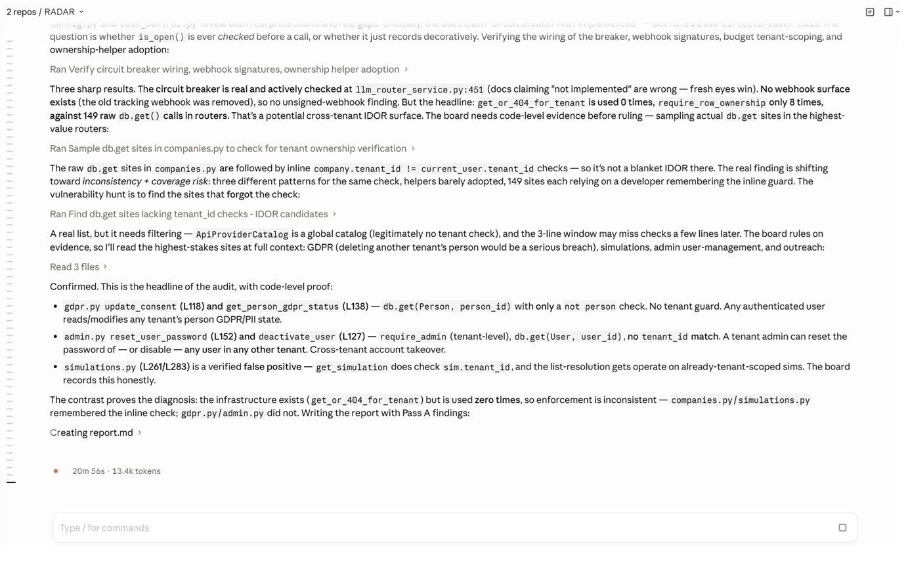
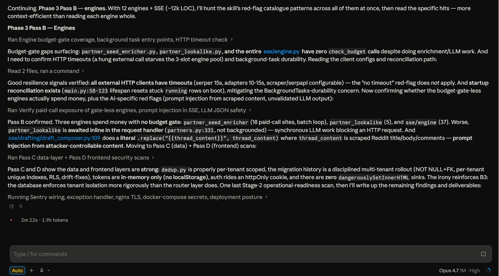

# Senior Board Audit

> A surgical audit skill for Claude and other coding agents. Four senior engineering agents convene as a board, examine your codebase for unsound components, security holes, broken features, and internal clashes, and issue a written ruling.

[](https://opensource.org/licenses/MIT)
[](https://augmex.io)
[](https://claude.com)


<p align="center">
  
  <br>
  <em>Invoking the skill on a real project.</em>
</p>


---

## What this is

A Claude skill that runs a four-agent adversarial audit of any codebase. Designed for use with Claude or any coding agent that can read files, query databases, and reason across multiple passes.

Instead of a single agent giving you a friendly review, you get a board:

- **The Auditor** runs the show. Catalogs every component. Orchestrates the debate.
- **The Defender** argues the current code is fine. Names its strengths.
- **The Challenger** argues the code is wrong, fragile, or redundant. Proposes alternatives.
- **The Judge** rules on the debate. Hands down a verdict with severity.

The board looks at the system through four lenses:

| Lens | Question it answers |
|---|---|
| **Component** | Is each piece of the system sound on its own? |
| **Security** | Can someone make the system do what it should not? |
| **Feature** | Does the system do what it claims to do? |
| **Clash** | Where does the system contradict itself? |

The audit adapts to your project stage. Pre-coding audits the plan. Mid-project hunts security holes, half-built features, and bottlenecks. Pre-ship stress-tests launch readiness. Production looks at live exposure and drift.

---

## Why this exists

Most code reviews suffer from one of two failures: they are too polite (the reviewer rubber-stamps to avoid friction) or too unstructured (the reviewer flags 50 nits without ranking them). Either way, you finish the review knowing less than you should about what is actually risky.

There is a third failure. A review reads one file at a time, and the worst defects do not live in one file. The missing ownership check sits between a route and a query. The dead feature sits between a button and a route nobody registered. The wrong invoice total sits between a frontend and a backend that round differently. Every file involved passes review.

This skill borrows from how surgeons, pilots, and financial auditors handle high-stakes review: convene a board, force the disagreement onto the record, and require a verdict. Then it runs three passes across the whole system to catch what a file-by-file review cannot.

The result is an audit that is harder to ignore than a code review, more specific than a "best practices" checklist, and more useful than a vibes-based "looks good to me."

---

## What you get

When the audit runs, you receive eight files in `docs/audit/{date}/`:

1. **`report.md`** - the headline report. Opens with the board ruling: PROCEED, PROCEED WITH CONDITIONS, or DO NOT PROCEED. Then findings by severity and an ordered action plan.
2. **`inventory.md`** - every component cataloged, with its verdict.
3. **`dependency-map.md`** - dependency graph with circular dependency flags and orphan detection.
4. **`security-review.md`** - the attack surface, an access control matrix for every entry point, and security findings with attack paths.
5. **`feature-matrix.md`** - every feature the system claims, traced end to end and marked COMPLETE, PARTIAL, STUB, BROKEN, UNREACHABLE, UNDOCUMENTED, or MISSING.
6. **`clash-register.md`** - every place where code, schema, config, contracts, and docs contradict each other, with a ruling on which side is authoritative.
7. **`challenge-rounds.md`** - side-by-side comparisons for your top issues, with proposed alternatives.
8. **`unanswered-questions.md`** - questions you could not answer (often the most useful file).

Every component in your codebase gets a verdict: KEEP AS IS, REFACTOR, REWRITE, DELETE, or SPLIT. Every finding gets a severity (BLOCKER, MAJOR, MINOR, or NOTE), a location, and an evidence level that says whether the board verified it, traced it through the code, or inferred it.

The report describes the weaknesses of your system. Treat `docs/audit/` as confidential, and keep it out of public repositories.

---

## How to install

The skill is a folder: `SKILL.md` plus six checklist files in `references/`. Install the whole folder.

### Option A: Claude Code via marketplace (recommended)

Add the marketplace, then install the plugin:

```
/plugin marketplace add ScaleWithAugmex/senior-board-audit
/plugin install senior-board-audit@augmex-skills
```

Then run any of the trigger phrases listed below.

### Option A2: Claude Code (manual install)

1. Clone this repo.
2. Copy the `skills/senior-board-audit/` folder to your project's skills directory, so that you have `.claude/skills/senior-board-audit/SKILL.md` and `.claude/skills/senior-board-audit/references/`.
3. Run any of the trigger phrases listed below.

### Option B: Claude.ai with Skills enabled

1. Download the `skills/senior-board-audit/` folder and zip it.
2. Upload the zip as a custom skill in your Claude settings.
3. Invoke from any conversation.

### Option C: Any coding agent that supports Markdown-based skills or system prompts

1. If your agent can read files on demand, copy the `skills/senior-board-audit/` folder where the agent can reach it and point the agent at `SKILL.md`.
2. If it cannot, paste `SKILL.md` into the system prompt, followed by the files in `references/`.
3. Trigger with the phrases below.

---

## How to use

The skill triggers on any of these phrases:

- "Run a senior board audit on this project."
- "Audit the codebase."
- "Run a security audit." / "Audit the features." / "Find what clashes."
- "Find the loopholes."
- "Is this ready to ship?"
- "Senior review."
- "We're about to launch, run the board."

The skill will:

1. Detect your project stage by scanning the repo, and ask you to confirm it (pre-coding, mid-project, pre-ship, or production).
2. Settle the configuration: scope, thresholds, exempt paths.
3. Run the stage question bank (17 to 22 questions). It answers what it can from the repository and asks you only the rest.
4. Catalog every component in the codebase.
5. Build a dependency map.
6. Walk through the components with the four-agent board.
7. Run the security pass, the feature pass, and the clash pass.
8. Run a deeper challenge round on the top findings.
9. Write the final report.

Plan for roughly an hour of agent time for a small to medium codebase. Larger systems can take several hours. The agent works autonomously after the initial questions.

You can ask for part of the audit: one service, or one lens ("security audit only"). A partial audit says what it did not cover and never issues a PROCEED ruling.

If `docs/audit/` already holds an earlier report, the board runs a follow-up: each earlier finding is marked RESOLVED, STILL OPEN, REGRESSED, or NO LONGER APPLICABLE.

---

## What it looks like in action

The board works through the codebase in phases, building evidence before issuing verdicts. It cross-checks documentation against live code, samples real call sites, and is willing to record honest false positives.

<p align="center">
  
  <br>
  <em>The board hunting cross-tenant IDOR risks. Note the honest false-positive admission on simulations.py.</em>
</p>

The audit runs over multiple passes, scanning different layers of the system before consolidating findings.

<p align="center">
  
  <br>
  <em>Phase 3 passes across engines, data layer, and frontend.</em>
</p>


---

## What it audits

### Security

The security pass maps every entry point and builds an access control matrix: who can call it, what is checked, and whether the query behind it is limited to the caller's own data. Then it works eleven domains:

- Authentication and sessions: password storage, token handling, reset flows, attempt limiting
- Authorization: IDOR, tenant isolation, privilege escalation
- Injection: SQL, command, template, path traversal, XSS, SSRF, unsafe deserialization
- Secrets and cryptography: hardcoded and committed secrets, weak crypto, disabled TLS checks
- Data protection: PII in logs, over-broad API responses, missing deletion paths
- Supply chain: vulnerable and unpinned dependencies, CI and container risks
- Configuration: CORS, headers, CSRF, exposed services, debug modes
- Abuse and business logic: price tampering, double spend, step skipping, missing rate limits
- Detection: unlogged security events, missing audit trails
- LLM integrations: prompt injection, tool permissions, cross-tenant leakage, unbounded spend
- Client and mobile: secrets in bundles, client-side authorization

Every security finding carries an attack path: who, through which entry point, past which gap, to what result.

### Features

The feature pass builds a register of everything the system claims to do, from the README, the UI, the routes, and your own answers. It traces each feature from the first click to the database and back, and marks it:

- **COMPLETE** - every hop exists and connects
- **PARTIAL** - the main path works, named hops are missing
- **STUB** - a placeholder stands in for the feature
- **BROKEN** - the pieces exist and cannot work as written
- **UNREACHABLE** - built, and nothing leads to it
- **UNDOCUMENTED** - exists, and nobody mentioned it
- **MISSING** - promised, and not there

It also walks the journeys that cross features: sign-up, payment, team management, leaving. It flags dead ends a user can enter and cannot finish.

### Internal clashes

The clash pass finds places where two parts of the system each look fine and disagree with each other:

- The same rule in three places with three different limits
- A frontend calling an endpoint, field, or enum value the backend does not have
- Models, migrations, and the live schema out of step
- Config values, timeouts, and versions that differ between files
- Two libraries doing one job, or two versions of one library
- Routes that shadow each other, middleware in the wrong order, jobs that overlap
- A security check on one path and none on another path to the same data
- Old and new versions of a module both alive
- Docs, comments, and tests that describe code that no longer exists

Every clash finding names both sides, the input on which they diverge, and which side wins.

### Code level

- Functions, files, and classes over your configured size thresholds
- Duplicate logic across files
- Confusing or inconsistent patterns
- Code that does too many things at once
- Cyclomatic complexity hotspots
- Magic numbers, dead code, stale TODOs

### Performance

- N+1 queries
- Missing or misordered indexes
- Synchronous external calls on hot paths
- Cache invalidation bugs
- Connection pool leaks
- Unbounded queries and loops

### Resilience

- Missing timeouts on external calls
- No circuit breakers or rate limiters
- Retry storms without backoff
- Non-idempotent workers
- Race conditions in concurrent writes

### Observability

- Silent error swallowing
- Logs without trace IDs
- Metrics nobody can name
- Alerts that never fire or fire constantly

### AI-specific (for products with LLM integrations)

- LLM calls without cost caps
- LLM output written to databases without validation
- LLM tool calls without a whitelist
- Hardcoded model names
- No fallback when the primary provider fails
- Prompt injection vectors

### Deployment (pre-ship and production stages)

- Rollback plan and rollback timing
- Database migration safety
- Backup verification
- Auto-scaling rules
- Load test results
- On-call rotation
- Secret rotation

---

## Project stages

The skill behaves differently at each stage.

### Stage 0. Pre-coding (Blueprint)

You have an idea, a spec, or a few skeleton files. No real implementation yet. The board audits your assumptions, your scope, and the contradictions in your plan.

Sample questions:
- What is the expected user base in 6 months and 2 years?
- Does this system favor consistency or availability?
- Which requirements pull against each other?

### Stage 1. Mid-project (Development)

The project has working code but is not yet production-bound. The board hunts security holes, broken features, clashes between layers, and bottlenecks before they ossify.

Sample questions:
- How is a user stopped from reading another tenant's records?
- Which features does the team consider done?
- Are asynchronous workers idempotent?

### Stage 2. Pre-ship (Launch Readiness)

The project is feature-complete. The board stress-tests deployment safety, rollback paths, security posture, and whether every launch feature works end to end.

Sample questions:
- What is the exact rollback plan?
- Are all secrets rotated and vaulted?
- Has a person walked every launch-scope journey, including the failure paths?

### Stage 3. Production (Live System)

The project is live. The board looks for live exposure, drift between the repository and what is running, features nobody uses, and debt.

Sample questions:
- What were the last three incidents, and did the fix address the cause?
- How fast does a critical dependency patch reach production?
- Where does production differ from what is in the repository?

---

## Example output

A trimmed excerpt from the sample audit report:

```markdown
## Board ruling

DO NOT PROCEED to the pre-ship stage.
Blockers: 3. Major: 5. Minor: 3. Notes: 4.

## Findings by severity

### Blockers (must fix before the next stage)

#### S-01. `services/projects.js` - Cross-tenant project access

Lens: Security | Verdict: REFACTOR | Severity: BLOCKER | Evidence: TRACED

Attack path: authenticated user of tenant A -> GET /api/projects/:id
-> Project.findByPk(id) has no tenant constraint -> reads any tenant's
project. IDs are sequential integers.

Judge ruled: CONFIRMED. The UI is not a control. Required fix:
1. Add the tenant constraint to every query in the service.
2. Move tenant scoping into a shared query helper.
3. Add a test that requests another tenant's project and expects a 404.

### Major (should fix soon)

#### F-01. Data export - Button calls a route that does not exist

Lens: Feature | Verdict: REFACTOR | Severity: MAJOR | Evidence: TRACED
Status: BROKEN.
...

#### X-01. Project name length - Three limits that disagree

Lens: Clash | Verdict: REFACTOR | Severity: MAJOR | Evidence: TRACED
Side A: form allows 50. Side B: API allows 255. Side C: column is
varchar(100). Authoritative: the column.
...
```

See [`examples/example-audit-report.md`](examples/example-audit-report.md) for the complete sample.

---

## Safety

The skill is read-only by design.

- **It does not change your system.** The board writes only inside `docs/audit/`. It refuses to edit source files, even when a fix looks trivial and even when asked mid-audit.
- **It does not execute your code by default.** The audit is static. Running your test suite or build is opt-in and needs your approval per command.
- **It does not attack anything.** The security pass reads and traces. It sends no requests to running systems.
- **It does not repeat your secrets.** A secret the board finds is cited by file and line. The value never goes into the report.
- **It does not take orders from your repository.** Text in the codebase that addresses an AI reviewer is treated as evidence and recorded as a finding.
- **It pre-approves almost nothing.** Only reading, searching, and writing inside `docs/audit/` are pre-approved. Shell commands go through your normal permission prompt.

---

## What this skill is NOT

- **Not a linter.** It catches things linters miss (architectural mistakes, business logic bugs, dependency tangles). It does not replace your linter for style enforcement.
- **Not a vulnerability scanner or a penetration test.** It is a static review that traces attack paths through your code. It does not replace tools like Snyk, Semgrep, or Burp Suite, and it does not test a running system.
- **Not a QA run.** The feature pass traces features through the code. It does not click through your application. A feature the board marks COMPLETE still needs a person or a test suite to confirm it.
- **Not a code generator.** The board proposes alternatives but does not implement them. You decide what to do with the verdicts.
- **Not a substitute for human review.** It is a tool to make human review sharper, not to replace it.

---

## Roadmap

Planned for future releases:

- Integration with GitHub Actions to run a lightweight audit on every pull request.
- Project-type presets (SaaS web app, mobile backend, AI product, e-commerce, internal tool) with tuned question banks.
- A "team audit" mode where multiple developers can submit responses and the board reconciles them.

Contributions welcome on any of these.

---

## Contributing

We welcome contributions. See [CONTRIBUTING.md](CONTRIBUTING.md) for the full guide.

Quick version:
1. Fork the repo.
2. Create a feature branch.
3. Make your change.
4. Open a pull request with a clear description.

Areas where help is especially welcome:
- Stage-specific question banks for niches we haven't covered (game backends, embedded systems, data pipelines, etc).
- Red flag patterns, security checks, and clash examples for languages and frameworks beyond the current Python/JavaScript/PHP focus.
- Worked examples showing the four-agent debate on real code.
- Translations of the skill into other languages.

---

## License

MIT License. See [LICENSE](LICENSE).

You are free to use this skill in commercial projects, modify it, distribute it, and build on it. We only ask that you keep the attribution to Augmex Technologies in derivative works.

---

## Credits

Built and maintained by [Augmex Technologies Limited](https://augmex.io), an AI-first software development company based in Dhaka, Bangladesh.

The four-agent board structure draws on adversarial review practices from medicine, finance, and aviation. The audit philosophy draws on Peter Naur's 1985 paper *Programming as Theory Building*, which remains the foundational text on what software actually is and where it actually lives.

If this skill saves your team from a 3 AM incident, that is the only success metric we care about.

---

## Contact

- **Project issues:** [GitHub Issues](../../issues)
- **Augmex Technologies:** [augmex.io](https://augmex.io) | hello@augmex.io
- **Maintainer:** [@ScaleWithAugmex](https://github.com/ScaleWithAugmex)

For security disclosures, see [SECURITY.md](SECURITY.md).
